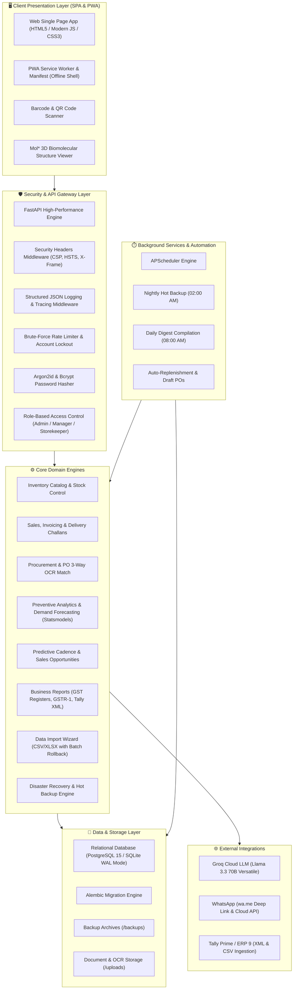

# Anishka Industries ERP — Architecture & System Design

This document details the high-level architecture, module breakdown, security mechanisms, and data flows for the Anishka Industries Inventory & Supply Chain ERP platform (Gurugram facility).

---

## 1. High-Level Architecture Diagram



---

## 2. Subsystem Breakdown

### 2.1 Security & Access Control
- **Argon2id & Bcrypt Hashing**: Passwords stored using state-of-the-art Argon2id hashing via Passlib. Legacy plaintext credentials from initial migrations are upgraded transparently on first successful authentication.
- **Brute-Force Protection**: Tracks consecutive failed login attempts per username and client IP. After 5 failed attempts, the account is locked for 15 minutes.
- **Forced Password Rotation**: Default seed passwords (`admin@2026`, `manager@2026`, `storekeeper@2026`) trigger a forced change password dialog upon login.
- **Security Headers**: Strict Content-Security-Policy (CSP), `X-Content-Type-Options: nosniff`, `X-Frame-Options: DENY`, `X-XSS-Protection: 1; mode=block`, and `Referrer-Policy: strict-origin-when-cross-origin`.
- **RBAC**: Three distinct privilege tiers:
  - **Admin**: Full catalog control, user provisioning, import wizard, database backups, Tally ledger configuration.
  - **Manager**: Procurement approvals, smart safety stock reorders, sales quotes, price tiers, GST compliance registers.
  - **Storekeeper**: Barcode scanning, physical stock adjustments, PO receiving, delivery challan verification.

### 2.2 Data Import Wizard
- **Universal Ingestion**: Ingests Anishka's own item catalog, supplier directory, and physical opening stock from CSV and Excel (`.xlsx`, `.xls`).
- **Flexible Column Mapping**: Normalizes column aliases (e.g. `Part No`, `item_code`, `SKU` $\to$ `sku`).
- **Row-by-Row Validation**: Analyzes every row prior to insertion, flagging missing fields, duplicates, negative numbers, and invalid foreign keys with interactive preview.
- **Transactional Commit & Rollback**: Every commit receives a unique `batch_id` (e.g. `BATCH-202611221530-AB12`). Any batch can be undone with one click, restoring prior inventory levels and stock movements.

### 2.3 Automated Backup & Disaster Recovery
- **Hot Atomic Snapshots**: Backs up SQLite databases online using the SQLite Online Backup API with prior `PRAGMA wal_checkpoint(TRUNCATE)`.
- **PostgreSQL Compatibility**: Executes `pg_dump` when `DATABASE_URL` is configured for PostgreSQL.
- **Scheduled & On-Demand**: Automatic nightly schedule at 02:00 AM plus on-demand admin triggers.
- **Retention Management**: Enforces configurable retention (default 14 days), automatically purging expired archives.
- **Integrity Checksums**: Every archive has a verified SHA256 hash.
- **Tested Restore CLI**: Rapid restore capability via:
  ```bash
  python backup_manager.py restore <backup_file>
  ```

### 2.4 Multi-Database Support (SQLite & PostgreSQL)
- **Zero-Config SQLite**: Embedded single-file database in WAL (Write-Ahead Logging) mode with `NORMAL` synchronous mode for low latency.
- **Cloud PostgreSQL**: Seamlessly switches to PostgreSQL via the `DATABASE_URL` environment variable (`postgresql://...`). Connection pooling (`pool_size=10, max_overflow=20`) and `pool_pre_ping=True` ensure resilience in production.
- **Alembic Migrations**: Schema evolution managed cleanly via Alembic revision scripts.

### 2.5 Observability & Structured Logging
- **Health Endpoint (`/api/health`)**: Reports real-time database connectivity, query latency, dialect, APScheduler state, active jobs, and facility identity.
- **Request Tracing**: Injects unique `X-Request-ID` and `X-Process-Time-Ms` into HTTP headers.
- **Structured JSON Logs**: Emits structured log records including timestamp, module, client IP, authenticated user, and response codes.
